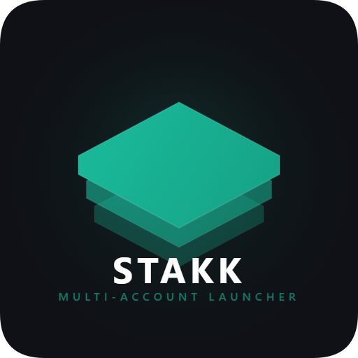
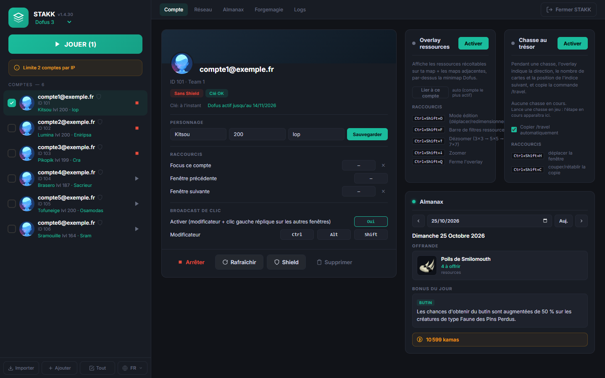
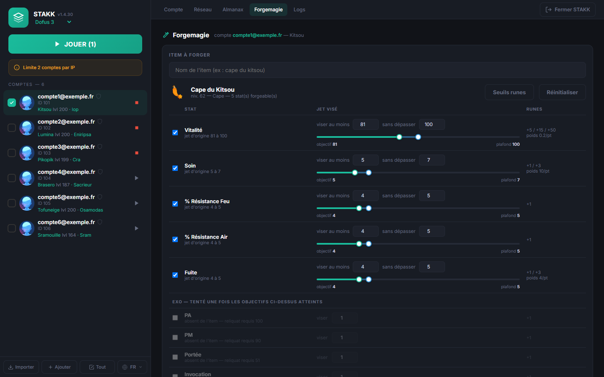
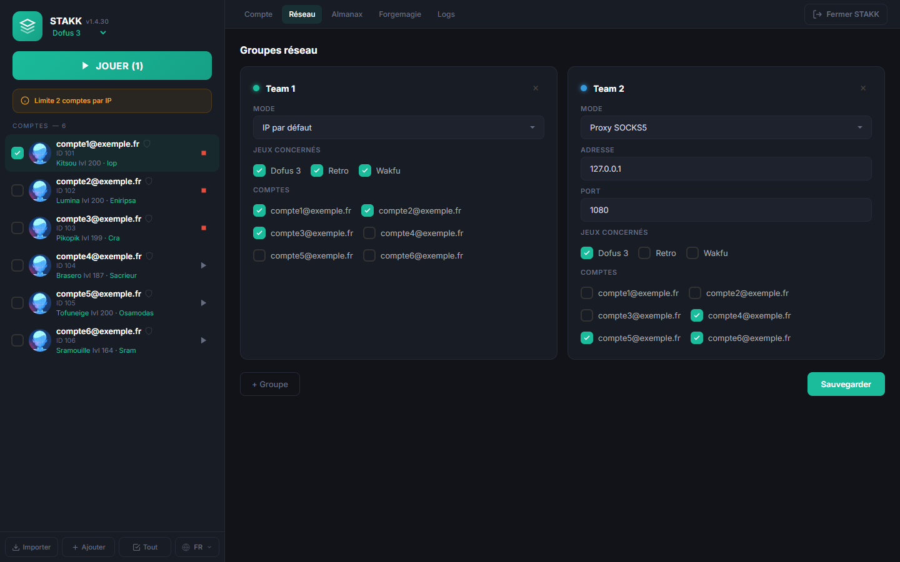
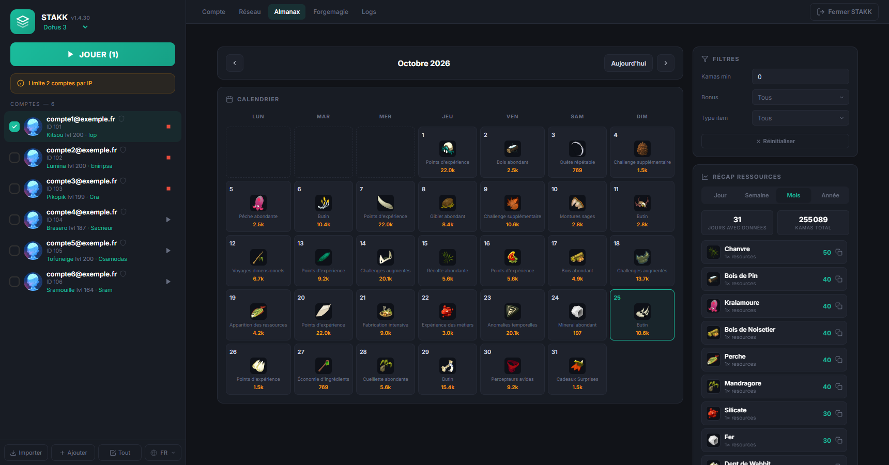
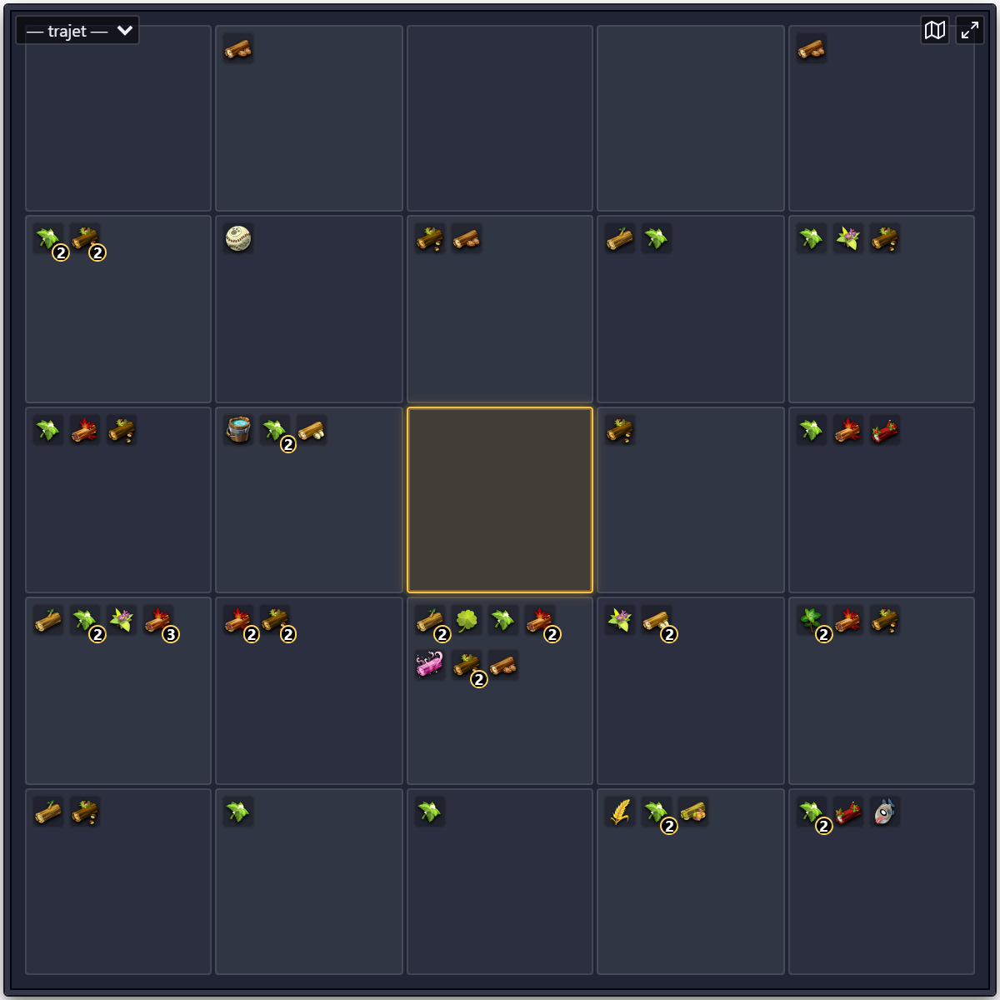
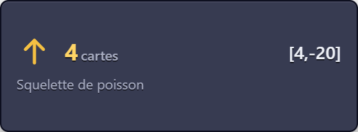
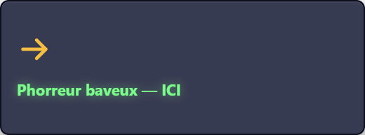

<p align="center">
  
</p>

<h1 align="center">STAKK</h1>

<p align="center">
  <a href="https://github.com/vDAKK/stakk-open-source/releases/latest"></a>
  
  
</p>

Lanceur multi-compte pour **Dofus 3**, **Dofus Retro** et **Wakfu**, avec overlay, forgemagie automatique, aide à la chasse au trésor et système de plugins.



STAKK tourne entièrement en local : pas de compte, pas d'abonnement, pas de serveur tiers. L'exe démarre une petite API sur `http://localhost:3000` et ouvre l'interface dans ton navigateur.

> STAKK n'est ni affilié à Ankama ni soutenu par Ankama. Le multi-compte et l'automatisation sont encadrés par les conditions d'utilisation des jeux : tu es seul responsable de l'usage que tu en fais.

## Fonctionnalités

- **Lancement multi-compte** sans le launcher Ankama : Dofus 3 (canaux release, beta, experimental), Retro et Wakfu, plusieurs comptes d'un clic.
- **Comptes** : import automatique depuis le launcher Ankama, ajout par identifiant / mot de passe ou par le navigateur (comptes Google, Apple…), certificat Shield (code email ou Authenticator).
- **Réseau** : groupes de comptes avec proxy SOCKS5 ou interface réseau dédiée, par jeu.
- **Raccourcis** pour passer d'une fenêtre à l'autre, **clic répliqué** sur toutes les fenêtres (Ctrl+clic).
- **Overlay** ressources et planner de trajet, **overlay chasse au trésor**.
- **Forgemagie** automatique.
- **Almanax**, suivi des abonnements Ankama, **Dofus Touch** (miroir Android via WebUSB).

## Captures

| Forgemagie | Réseau |
|---|---|
|  |  |



### Overlays

Fenêtres transparentes posées par-dessus le jeu.

| Ressources (5×5 autour du perso) | Chasse au trésor |
|---|---|
|  | <br><br><br><sub>Indice suivant, puis phorreur repéré sur la carte.</sub> |

<sub>Captures prises avec des comptes fictifs et une chasse simulée ; les ressources viennent de dofusdb.</sub>

## Démarrage rapide

### Depuis une release (Windows)

1. Télécharge `stakk-vX.Y.Z.zip` dans les releases et extrais-le où tu veux.
2. Lance `stakk.exe` (ou `install.bat` pour créer un raccourci avec l'icône).
3. Le navigateur s'ouvre sur `http://localhost:3000`. Tes comptes du launcher Ankama sont importés automatiquement.

Pour macOS, voir [MAC.md](MAC.md).

### Depuis les sources

Prérequis : Windows 10/11, **Node.js 18** (le binding natif de Frida 15 est compilé pour Node 18) et le launcher Ankama avec au moins un jeu installé.

Avec `npm install` sous un autre Node que la 18, npm s'arrête sur `EBADENGINE` : passe en Node 18 (`nvm use`, le dépôt contient un `.nvmrc`).

```bash
npm install
npm start          # démarre l'API et ouvre http://localhost:3000
```

Autres commandes :

```bash
node index.js list                  # liste les comptes
node index.js launch 1,2 dofus3     # lance les comptes 1 et 2 sans l'interface
node index.js import                # importe les comptes du launcher Ankama
node index.js diag                  # rapport d'environnement (utile sur macOS)
```

Variable utile : `STAKK_NO_BROWSER=1` empêche l'ouverture automatique du navigateur.

## Plugins

Toute fonctionnalité qui n'est pas du lancement pur est un plugin. Le panneau **Modules** (clic sur le numéro de version, en haut à gauche) liste les plugins chargés et leur état.

| Plugin | Rôle |
|---|---|
| `organizer` | Raccourcis clavier pour passer d'une fenêtre de jeu à l'autre |
| `click-broadcast` | Réplique un Ctrl+clic de la fenêtre active vers les autres |
| `overlay-backend` | Overlay des ressources, planner de trajet |
| `chasse` | Overlay et suivi de la chasse au trésor |
| `fm` | Forgemagie automatique |
| `key-refresh` | Renouvelle les clés Ankama avant expiration |
| `sub-tracker` | Date de fin d'abonnement Ankama par compte |

Tous sont actifs par défaut.

### Désactiver un plugin

Crée un fichier `plugins.json` à côté de `stakk.exe` (ou à la racine du dépôt en dev) :

```json
{
  "disabled": ["sub-tracker"]
}
```

### Écrire son propre plugin

Dépose un fichier `.js` dans un dossier `plugins/` à côté de `stakk.exe`. Le nom du fichier devient le nom du plugin ; s'il porte le nom d'un plugin intégré, il le remplace.

Un plugin exporte une factory qui reçoit la « deps bag » de STAKK : événements (`launch`, `detach`, `ready`, `accounts-imported`), enregistrement de routes HTTP, accès aux comptes, tap sur les paquets du jeu, modules Node… Exemple commenté : [examples/plugins/launch-log.js](examples/plugins/launch-log.js). La liste complète des dépendances est dans `getPluginApi()` ([lib/web-server.js](lib/web-server.js)).

## Où sont les données

| Emplacement | Contenu |
|---|---|
| `release/data/<accountId>` | Un fichier par compte : clé API Ankama, refresh token, certificat Shield. **Ne partage jamais ce dossier.** |
| `config.json` | Groupes réseau (proxy, interface) |
| `plugins.json`, `plugins/` | Sélection et plugins persos |
| `~/.stakk/` | Réglages des plugins (overlay, langue, forgemagie…) |

## Structure du dépôt

```
index.js              point d'entrée (interface web par défaut, ou CLI)
lib/web-server.js     API locale, lancement des jeux, deps bag des plugins
lib/plugins.js        chargeur de plugins
lib/*.js              modules cœur (zaap, haapi, frida, proxy…) et plugins
ui/index.html         interface web
overlay/              overlays Electron (ressources, chasse) et planner
test/                 tests (npm test)
```

## Build

```bash
npm run build              # Windows → dist/stakk.exe
npm run build:mac:cross    # macOS (depuis Windows), voir MAC.md
```

Le workflow GitHub Actions [build.yml](.github/workflows/build.yml) teste et compile l'exe Windows à chaque push sur `main` et publie le zip dans la release `v<version de package.json>` : créée au premier build d'une version, son zip est remplacé aux builds suivants. Pour sortir une nouvelle release, monte la version dans `package.json`.

## Tests

```bash
npm test                   # suite complète
npm run test:fm:ui         # parcours navigateur de la forgemagie (Chrome requis)
```

Après une maintenance Dofus, [MAINTENANCE_CHECKLIST.md](MAINTENANCE_CHECKLIST.md) liste ce qui casse d'habitude et comment le réparer.

## Licence

[GPL-3.0](LICENSE). Les forks distribués doivent rester sous GPL-3.0, sources incluses.
